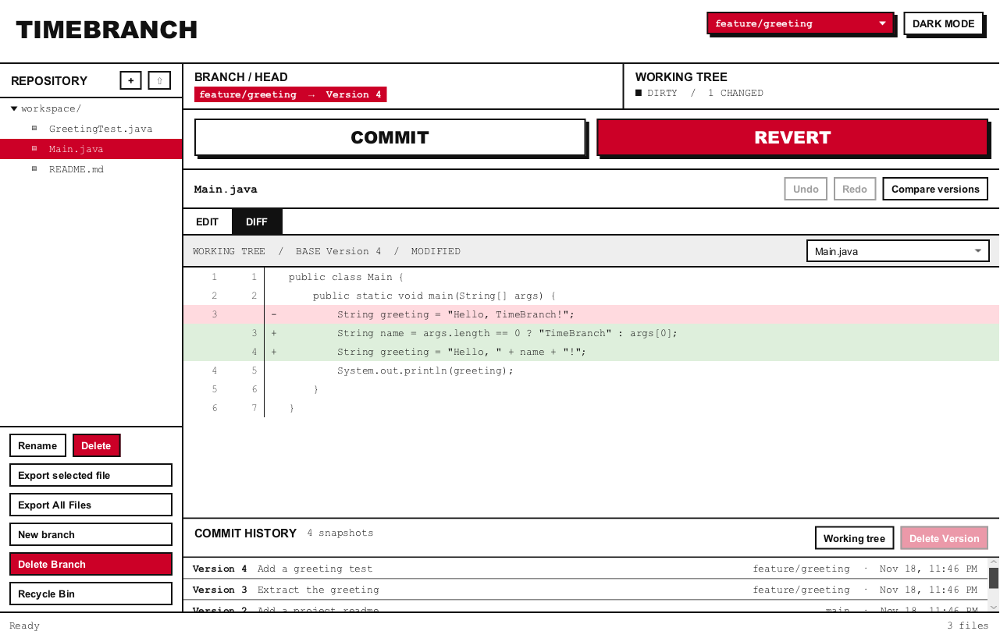
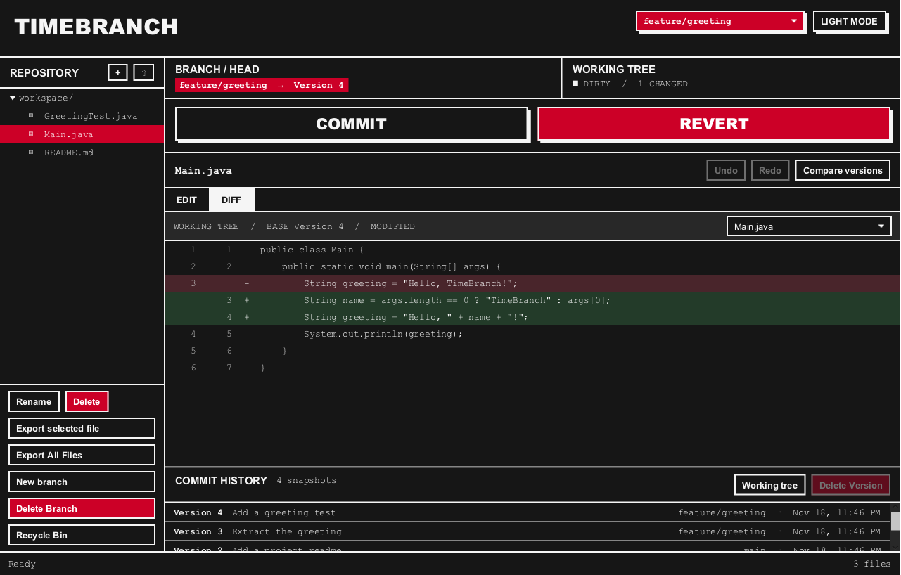

# TimeBranch

TimeBranch is a JavaFX desktop app for learning local version control. Edit text and source files, save immutable snapshots, compare versions, and recover files from committed history.

## Install and run

1. Install a JDK 17 or later and Apache Maven 3.9 or later. Check your setup with `java -version` and `mvn -version`.
2. Clone the repository and start the app from the project directory. Maven downloads the JavaFX dependencies on the first run. GitHub may ask you to authenticate to clone a private repository.

```bash
git clone https://github.com/bhagieradaa/TimeBranch.git
cd TimeBranch
mvn javafx:run
```

## Screenshots

The screenshots show the same sample workspace in both themes. The Diff tab highlights additions and removals while the dashboard shows the active branch, working-tree status, and commit history.

| Light mode | Dark mode |
| --- | --- |
|  |  |

## Features

- **Workspace editing.** Create, rename, delete, and import UTF-8 files from the repository sidebar. Undo and Redo apply to local workspace changes.
- **Commit History.** Commit saves a snapshot of all current files. History shows sequential labels such as **Version 1** and **Version 2**. Branch HEAD identifies the active branch’s latest snapshot, and the working-tree status and changed-file count compare the current files against it.
- **Diff and Compare Versions.** Inspect a working-tree or commit diff, including added or deleted files and line-ending changes. Use **Compare versions** to choose any two snapshots and a file.
- **Branch management.** Create a branch from the current commit and switch branches using the dropdown. **Delete Branch** protects `main`, keeps shared commits, removes unreachable commits, and restores the committed `main` workspace. Operations that discard uncommitted changes ask for confirmation.
- **Revert and Delete Version.** Revert restores files from the active branch’s history without creating a new commit. Delete Version removes an unshared branch-tip snapshot with no children, moves HEAD back to its parent, and keeps your working files. The initial version is protected.
- **Recycle Bin.** Recover a missing file from the latest snapshot containing it in the active branch’s history.
- **Export.** Export the selected file or use **Export All Files** to write the current workspace to a fresh `TimeBranchProject` folder. Bulk export leaves existing destinations intact.
- **Light and dark themes.** Switch themes from the top bar.

## Local storage

The workspace is stored at `~/.timebranch/workspace.tbr`. TimeBranch validates the history and file data when loading, uses a lock to prevent simultaneous writes from two running copies, and retains working files across restarts. When opening an older workspace with orphaned commits, it saves a backup beside the workspace before removing the unreachable snapshots. Surviving revisions keep their internal IDs.

## Data structures and algorithms

| Implementation | Role |
| --- | --- |
| General revision tree | Parent and child links represent branching. Reachability from surviving branch heads determines which snapshots to keep. |
| Custom chained hash table | Looks up revisions by stable internal ID in average constant time. |
| Custom doubly linked list | Keeps revisions in chronological order, supports newest-first traversal, and allows entries to be unlinked during cleanup. |
| Custom linked stacks | Track workspace Undo and Redo using working-file snapshots. |
| Longest common subsequence (LCS) | Aligns lines for diffs within a bounded comparison window. Large windows use positional comparison after matching the common prefix and suffix. |

## Verify

```bash
mvn clean verify
```

The JUnit suite covers file operations, export safety, diffs, branch isolation, version deletion, orphan cleanup, repository consistency, and restart persistence. The JavaFX application and repository engine are under `src/main/java/dev/timebranch/`. The standalone browser demo is under `web/` and uses sample data.
